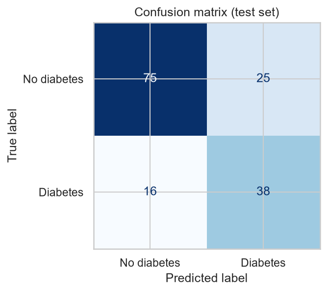
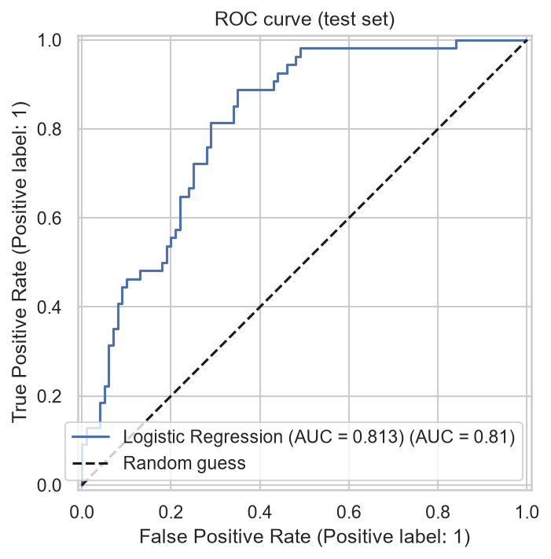
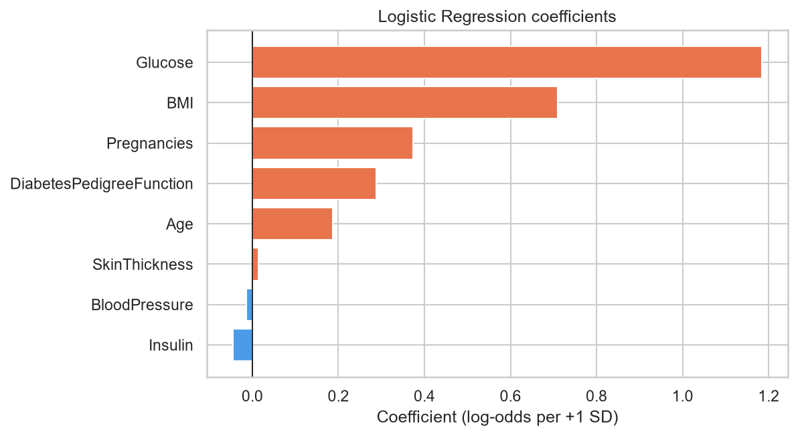

# 🩺 Diabetes Prediction using Logistic Regression

A beginner-friendly machine-learning project that predicts whether a patient has diabetes (`Outcome`: **0 = No diabetes, 1 = Diabetes**) from eight diagnostic measurements, using the **Pima Indians Diabetes Database** from Kaggle.

> ⚠️ **Disclaimer:** This is a small, historical dataset from one specific population. The model is for **learning classification concepts only — not for medical diagnosis.**

---

## 📌 Project at a glance

| | |
|---|---|
| **Objective** | Predict `Outcome` (0 = No diabetes, 1 = Diabetes) |
| **Dataset** | Pima Indians Diabetes Database (Kaggle) — `diabetes.csv`, 768 rows × 9 columns |
| **Model** | Median imputation + `StandardScaler` + balanced Logistic Regression |
| **Split** | 80 / 20 stratified train-test, `random_state=42` |

**Input features:** `Pregnancies`, `Glucose`, `BloodPressure`, `SkinThickness`, `Insulin`, `BMI`, `DiabetesPedigreeFunction`, `Age`

## 🔄 Workflow

```
load Kaggle CSV → inspect data → replace invalid zeros → train-test split
   → median imputation → scaling → train Logistic Regression
   → evaluate → interpret coefficients
```

1. **Load & inspect** – shape, dtypes, summary statistics, class balance (~65 % no diabetes / ~35 % diabetes), correlation heatmap.
2. **Replace invalid zeros** – a value of `0` is impossible for `Glucose`, `BloodPressure`, `SkinThickness`, `Insulin` and `BMI`, so these are treated as missing (`NaN`). `Pregnancies` is left as is because 0 is valid.
3. **Train-test split** – stratified, so both sets keep the same class ratio.
4. **Pipeline** – `SimpleImputer(median)` → `StandardScaler` → `LogisticRegression(class_weight="balanced")`. Everything is fitted on the training set only, so there is **no data leakage**.
5. **Evaluate** – accuracy, precision, recall, F1, ROC-AUC, confusion matrix, ROC curve.
6. **Interpret** – standardised coefficients and odds ratios.
7. **Robustness check (bonus)** – 5-fold stratified cross-validation.

## 📊 Results (fixed test split, n = 154)

| Metric | Result | Meaning |
|---|---|---|
| Accuracy | **0.734** | Overall correct predictions |
| Precision | **0.603** | Reliability of positive predictions |
| Recall | **0.704** | Actual positive cases detected |
| F1-score | **0.650** | Balance of precision and recall |
| ROC-AUC | **0.813** | Overall class-separation ability |

**Confusion matrix**

| | Predicted 0 | Predicted 1 |
|---|---|---|
| **Actual 0** | TN = 75 | FP = 25 |
| **Actual 1** | FN = 16 | TP = 38 |

**5-fold cross-validation (mean ± std):** ROC-AUC 0.836 ± 0.022 · Recall 0.727 ± 0.052 · Accuracy 0.747 ± 0.045

<p align="center">
  
  
</p>

### Coefficient interpretation

Features are standardised, so each coefficient is the change in log-odds per +1 standard deviation.

| Feature | Coefficient | Odds ratio |
|---|---|---|
| Glucose | 1.183 | 3.27 |
| BMI | 0.710 | 2.03 |
| Pregnancies | 0.373 | 1.45 |
| DiabetesPedigreeFunction | 0.288 | 1.33 |
| Age | 0.186 | 1.21 |
| SkinThickness | 0.014 | 1.01 |
| BloodPressure | -0.015 | 0.98 |
| Insulin | -0.045 | 0.96 |

<p align="center"></p>

## 💡 Key findings

- The model reaches **ROC-AUC ≈ 0.813** and detects **≈ 70.4 %** of the positive cases (38 of 54) on the fixed test split.
- **Glucose** and **BMI** have the strongest positive coefficients.
- **Recall is especially important** in a screening-style task because false negatives are missed positive cases. Balanced class weights trade some precision for higher recall.
- **Limitation:** small historical dataset from a specific population → suitable for learning, not for clinical use.

## 📁 Repository structure

```
diabetes-logistic-regression/
├── data/
│   └── diabetes.csv                       # Pima Indians Diabetes dataset
├── images/                                # Plots generated by the notebook
├── diabetes_logistic_regression.ipynb     # Executed notebook (all outputs visible)
├── requirements.txt
└── README.md
```

## 🚀 How to run

```bash
# 1. (optional) create a virtual environment
python -m venv venv
source venv/bin/activate        # Windows: venv\Scripts\activate

# 2. install dependencies
pip install -r requirements.txt

# 3. open the notebook
jupyter notebook diabetes_logistic_regression.ipynb
```

Run **Kernel → Restart & Run All** to reproduce every table and plot. The notebook expects `data/diabetes.csv` relative to its own folder.

## 📝 Submission checklist

- [ ] Add your name and date at the top of the notebook (and in the PDF report)
- [ ] Keep all metric outputs and graphs visible (restart & run all, then save)
- [ ] Rewrite the final conclusion (Section 10) in your own words
- [ ] Submit the executed `.ipynb` and the one-page PDF

## 📚 Data source

[Pima Indians Diabetes Database — Kaggle](https://www.kaggle.com/datasets/uciml/pima-indians-diabetes-database) (originally from the National Institute of Diabetes and Digestive and Kidney Diseases).
